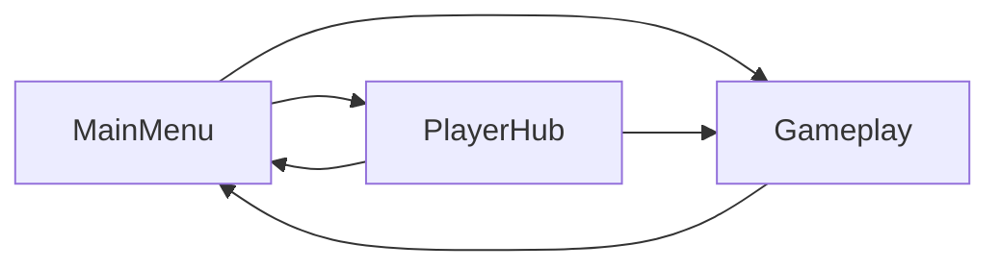
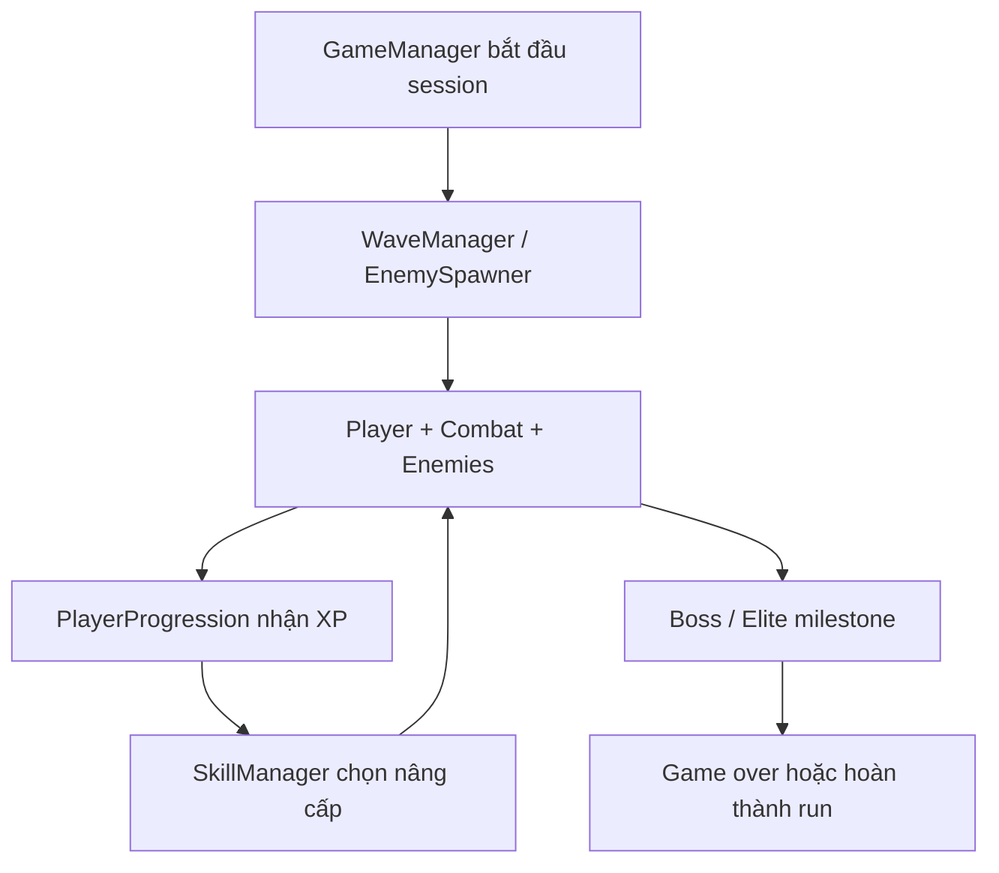

# Kiến trúc MonsterSurvival

Tài liệu này mô tả ownership và luồng chính; scene/prefab vẫn là nguồn cấu hình
thực tế cho component và serialized reference.

## Luồng scene

- **MainMenu** khởi tạo luồng vào game và lựa chọn profile.
- **PlayerHub** hiển thị tiến trình dài hạn như inventory, equipment, shop và
  achievements. Hub có thể được load additive từ menu.
- **Gameplay** sở hữu vòng đời một run: spawn wave, combat, level-up, boss,
  game-over và trở về menu.

Scene production nằm tại `Assets/MonsterSurvival/Content/Scenes`. Mọi scene cần
load bằng `SceneManager` phải được Enabled trong Build Profile production.

## Vòng gameplay

`GameManager` là chủ trạng thái session. `WaveManager` quyết định tiến độ và độ
khó wave; `EnemySpawner` chỉ chịu trách nhiệm tạo enemy hợp lệ. `Health` phát sự
kiện damage/death; UI lắng nghe trạng thái thay vì sở hữu gameplay rule.

## Ownership theo domain

| Domain | Trách nhiệm | Vị trí |
|---|---|---|
| Core | Session state, health và primitive dùng chung | `Code/Runtime/Core` |
| Player | Điều khiển, chỉ số, progression, shield, shooting | `Code/Runtime/Player` |
| Combat | Projectile, impact và dữ liệu hiệu ứng đạn | `Code/Runtime/Combat` |
| Enemies | AI chung và archetype enemy | `Code/Runtime/Enemies` |
| Waves | Spawn, wave scaling và elite scheduling | `Code/Runtime/Waves` |
| Skills | Skill data và lựa chọn nâng cấp trong run | `Code/Runtime/Skills` |
| Bosses | Hành vi boss dùng chung | `Code/Runtime/Bosses` |
| World | Map, pathfinding và obstacle runtime | `Code/Runtime/World` |
| UI | HUD, menu, popup và presentation | `Code/Runtime/UI` |
| Audio | Music/SFX orchestration và gameplay audio events | `Code/Runtime/Audio` |
| VFX | Component chỉ điều khiển visual effect | `Code/Runtime/VFX` |
| Features | Module sở hữu code và content chuyên biệt | `Features/<Feature>` |

## Các entry point quan trọng

- `Code/Runtime/Core/GameManager.cs`: trạng thái và thời gian của một run.
- `Code/Runtime/Player/PlayerController.cs`: input di chuyển và dash.
- `Code/Runtime/Waves/WaveManager.cs`: tiến trình và scaling wave.
- `Code/Runtime/Waves/EnemySpawner.cs`: chọn vị trí và tạo enemy.
- `Code/Runtime/Skills/SkillManager.cs`: hàng đợi level-up và áp dụng lựa chọn.
- `Code/Runtime/UI/MainMenuController.cs`: thao tác menu chính.
- `Features/Milestones/MS7J1` đến `MS7J5`: entry, UI và QA của Player Hub.
- `Code/Editor/MSCoreGameplayAudit.cs`: kiểm tra cấu hình gameplay cốt lõi.

## Ranh giới dữ liệu

- ScriptableObject chứa dữ liệu cân bằng/tuning dùng lại giữa nhiều object.
- Prefab chứa composition và serialized reference của entity.
- Scene chứa composition cấp màn chơi, không nên trở thành nơi duy nhất giữ
  gameplay rule.
- Save/Profile là dữ liệu dài hạn; state của một gameplay session không được tự
  động ghi đè profile nếu run chưa đi qua save boundary được thiết kế.

## Khi thêm tính năng mới

Nếu tính năng chỉ cần vài component dùng chung, đặt vào domain hiện hữu. Nếu nó
sở hữu UI, data, prefab và editor tooling riêng, tạo `Features/<Feature>` với
`Runtime`, `Editor`, `Data` hoặc `Prefabs` khi thực sự cần. Không tạo abstraction
hoặc assembly definition chỉ để làm cấu trúc trông phức tạp hơn.
